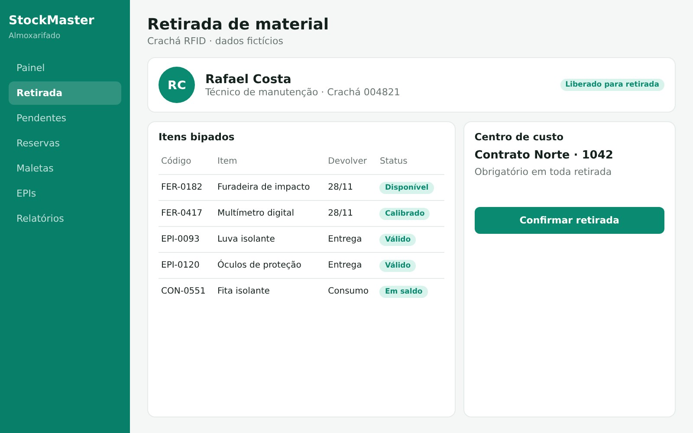
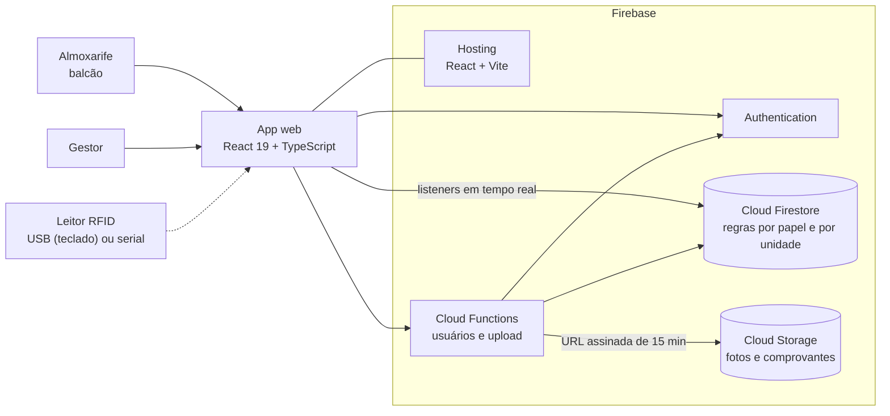

# StockMaster · gestão de almoxarifado

Sistema web de almoxarifado para empresa com equipe técnica: ferramentas, EPIs, EPCs, consumíveis e maletas controlados do recebimento à devolução, com retirada por crachá RFID.

> O código é privado (projeto de cliente). Este repositório documenta o projeto.

Tela de apresentação com dados fictícios. As telas reais têm dados de funcionários e não são mostradas.

## Problema

O almoxarifado empresta ferramentas e entrega EPIs e material para técnicos que atendem vários contratos. O controle em caderno e planilha não respondia às perguntas do dia a dia: quem está com qual ferramenta, até quando, em qual contrato o custo deve cair, qual EPI está vencido e qual equipamento está em manutenção ou com calibração vencida.

## Solução

Uma aplicação React servida pelo Firebase, com dois perfis principais: o **almoxarife** opera o balcão (retirada, separação, entrega, devolução, maletas) sem ver valores; o **gestor** tem a visão completa, com custos, relatórios, manutenção, calibração e configurações. Cada retirada exige o centro de custo (o contrato), e o sistema bloqueia o que não pode sair.

## Funcionalidades principais

- **Retirada:** identificação do colaborador por crachá RFID ou busca; ferramenta patrimoniada por código de barras (uma unidade por bipe); bloqueios antes de registrar (atraso, EPI vencido, item em manutenção, calibração vencida, sem saldo); centro de custo obrigatório.
- **Pendentes (romaneio):** separar, conferir, editar itens, cancelar ou confirmar a entrega na mesma tela; impressão do romaneio e do comprovante de empréstimo.
- **Reservas:** vários itens por reserva, com bloqueio de disponibilidade pelos dias do prazo; cancelamento com motivo.
- **Maletas:** modelos definidos pelo gestor, montagem a partir do estoque, entrega avulsa, troca de item avariado e termo de responsabilidade impresso na primeira entrega.
- **Devolução e ocorrências:** devolução total ou parcial (com prorrogação do saldo em aberto), perda, extravio e avaria registrados como ocorrência com solução.
- **Estoque:** entrada por nota fiscal, inventário, EPIs e consumíveis com saldo, histórico por item.
- **Manutenção e calibração** de equipamentos.
- **Relatórios e painel:** gráficos, exportação para Excel e PDF.
- **Cadastros:** colaboradores, centros de custo, fornecedores, terceiros, usuários e importação por planilha.

## Arquitetura

## Decisões técnicas e desafios

1. **Baixa de estoque em transação.** Registrar um pedido lê todos os itens dentro de uma transação do Firestore, confere a unidade e o saldo disponível e só então baixa o estoque e grava o movimento; editar ou cancelar o pedido antes da entrega ajusta a reserva da mesma forma. *Por quê:* dois almoxarifes no balcão não podem entregar a mesma última unidade.
2. **Crachá RFID sem driver.** O leitor em modo teclado é capturado em nível de janela, e o intervalo entre teclas separa a leitura do cartão da digitação humana; leitores em porta serial usam a Web Serial API do navegador. *Por quê:* funciona com o leitor barato que já existia, sem instalar nada na máquina do balcão.
3. **Regras de acesso no banco, não só na tela.** As regras do Firestore conferem papel (gestor, almoxarife, técnico) e unidade em cada coleção, e são testadas contra o emulador com `@firebase/rules-unit-testing`. Criar usuário, trocar papel e definir senha passam por Cloud Functions. *Por quê:* o almoxarife não pode ler custo nem alterar cadastro, mesmo chamando a API direto.
4. **Poucas leituras no Firestore.** O painel lê um documento agregado por unidade em vez de varrer as movimentações; cada rota carrega só os dados do seu domínio, conforme o papel, e mantém um listener em tempo real (sem recarregar a página). Retirada e devolução são a exceção: carregam tudo no login, porque o balcão não pode esperar. *Por quê:* custo e tempo de resposta previsíveis num banco cobrado por leitura.
5. **Upload controlado pelo servidor.** Fotos e comprovantes sobem por funções que conferem o perfil de quem envia, o tipo de pasta e o tamanho máximo, e devolvem URLs assinadas de curta duração.
6. **Validação em camadas.** Vitest para regras de domínio e formulários, Playwright para fluxos críticos (acesso por papel, retirada e devolução, maletas, reservas) e um comando único que roda lint, tipos, testes e build antes de publicar.

## Stack

| Camada | Tecnologias |
|---|---|
| App | React 19, TypeScript, Vite, React Router, Tailwind CSS 4, Radix UI (shadcn/ui), react-hook-form, zod, date-fns |
| Relatórios | Recharts, SheetJS (xlsx), jsPDF, html2canvas |
| Backend | Firebase: Authentication, Cloud Firestore, Cloud Storage, Cloud Functions, Hosting |
| Testes | Vitest, Testing Library, Playwright, @firebase/rules-unit-testing, emuladores do Firebase |
| Entrega | Firebase Hosting; build de pré-visualização por branch na Vercel |

## Meu papel

Projeto, desenvolvimento e implantação.
